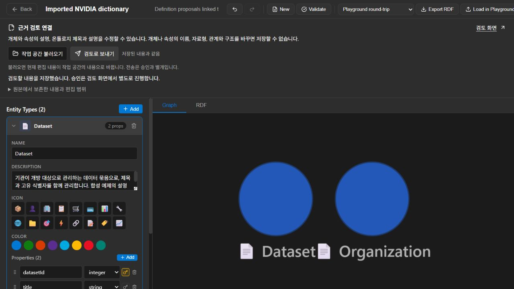
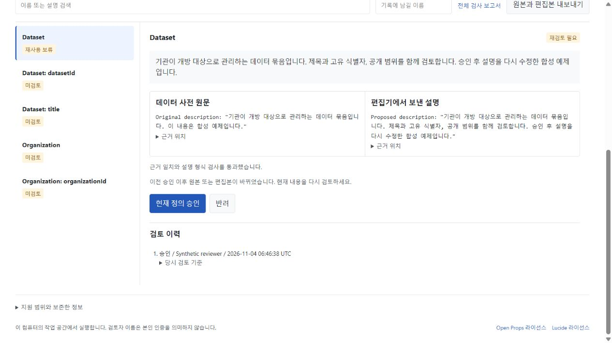

# A live dictionary review workspace

[한국어](#한국어) / English

This local service connects a native NVIDIA Auto Ontology model export to the actual Microsoft Ontology Playground Designer and this extension's review store. It imports JSON or safe YAML, preserves the exact UTF-8 source, opens a bound draft in the editor, and records explicit decisions against the current evidence. No model server or API key is needed.





[Watch the 20-second captured-state walkthrough](assets/connection-walkthrough.mp4). It combines four actual in-app browser captures: import, editing, approval and subsequent review invalidation. These are captured states, not a screen recording of continuous motion.

## Run

Build [the connected Playground fork](https://github.com/SakJaeLim/Ontology-Playground) first. In PowerShell, inside its checkout:

```powershell
npm ci --ignore-scripts
$env:VITE_BASE_PATH = '/editor/'
$env:VITE_EVIDENCE_REVIEW = 'true'
npm run build
Remove-Item Env:VITE_BASE_PATH
Remove-Item Env:VITE_EVIDENCE_REVIEW
```

Then, from this extension's installed Python environment:

```powershell
python -m pip install ".[test]"
New-Item -ItemType Directory review-workspace
python -m evidence_wiki serve review-workspace --editor-dist PATH_TO_PLAYGROUND_BUILD --port 8770
```

Open `http://127.0.0.1:8770/`. Use an empty directory for a new workspace. The service refuses an unrelated existing workspace. Run only one server per workspace; simultaneous CLI writers or other server processes are unsupported.

1. Choose a native Auto Ontology JSON/YAML file, or load the clearly labelled synthetic example.
2. Open the editor and choose **작업 공간 불러오기**. This explicitly replaces the current editor draft.
3. Edit an entity or property description, then choose **검토로 보내기**.
4. Open **검토 화면** in its separate tab. Compare the source and proposal and record an explicit review.
5. Change a definition again. Refresh review to see the earlier decision retained and the current definition requiring review.

The source file limit is 1 MiB, with at most 200 reviewable definitions. Only ontology name/description and bound entity/property descriptions can change in this first adapter. Structural edits, including renaming or reordering properties, fail explicitly. The Designer's property model has no stable property IDs, so the service does not guess identity after these edits. Loading the same original is a no-op that preserves the current proposal. Loading a changed source starts a new projection.

## Source and review boundaries

The adapter follows NVIDIA's `AutoOntologyModelDocument` at commit `fb496d406acfd34db0af3c5d188080097779021f`. A term's `represents` values identify **tables**; column attributes bind through `column_id`. Primary-key lists contain column names. The synthetic example was validated against that upstream Pydantic model.

Raw source bytes and their hash are preserved in immutable files. Edited projections and pointer-labelled extracts are committed as complete generations, with `workspace.json` replaced last. The existing SQLite decision history remains. Changed generations conservatively require new review; unrelated definitions may also need review because the generation paths change. A changed source that was observed and then restored does not revive its previous approval.

The extracts are representations of the submitted dictionary and editor draft, not independent factual evidence. SHACL checks whether a description is a nonempty string within the length limit. A matching extract or passing constraint does not prove truth or semantic equivalence. A reviewer must make that judgment. Reviewer names are local labels, not authenticated identities; the store is not tamper-proof.

Foreign keys, joins, SQL attributes, samples and zones stay in the raw source and export envelope. They are not projected into invented relationship cardinalities. The export contains the exact source plus the separate proposal, bindings and notices. It is not a rewritten NVIDIA model for automatic reimport. Fabric IQ's naming and identifier validation remains separate.

The HTTP service binds only `127.0.0.1`. Reads require its session cookie; writes additionally require the exact host, origin and CSRF token, with a current workspace revision. It does not enable CORS or accept arbitrary local paths, SQL execution or remote fetches. It serves a separately built Microsoft editor; Microsoft code is not copied into this Python package. The NVIDIA model inference service is not deployed. Native LLM Wiki answers are not intercepted.

## 한국어

NVIDIA 데이터 사전을 가져와 Microsoft의 실제 온톨로지 편집기에서 설명을 다듬고, 원문과 비교해 검토 기록을 남기는 로컬 작업 공간입니다. 위 명령으로 편집기를 빌드한 뒤 Python 서비스에 `build` 폴더를 지정하면 됩니다.

파일을 가져온 뒤 편집기의 **작업 공간 불러오기**를 누르세요. 개체와 속성 설명, 온톨로지 제목과 설명을 수정하고 **검토로 보내기**를 누르면 현재 초안이 저장됩니다. **검토 화면**은 별도 탭으로 열립니다. 원문과 수정안을 비교하고 검토자 이름을 적어 승인하거나 반려할 수 있습니다. 저장만으로 승인되지는 않습니다.

승인한 내용을 다시 수정하면 이전 검토 이력은 남고 현재 내용은 재검토 대상이 됩니다. 다른 탭에서 이미 작업 공간을 바꾼 경우 오래된 화면의 저장은 거부되며 편집 내용은 화면에 남습니다. 최신 내용을 불러오기 전에 현재 편집 내용을 별도로 보관하세요.

첫 연결에서는 설명 편집을 지원합니다. 이름, 자료형, 순서, 관계와 구조 변경은 저장할 수 없습니다. 원본 파일과 편집본은 따로 보존하며, SQL이나 관계 등 화면에 옮기지 않은 정보는 내보내기 파일에 포함됩니다. 예제에는 실제 기관 정보가 없습니다.

형식 검사가 통과해도 설명이 사실이거나 원문과 의미가 같다는 보장은 없습니다. 원문과 제안문은 모두 사용자가 넣은 자료에서 나온 것이므로, 검토자가 직접 확인해야 합니다. 이 서비스는 같은 작업 공간에 여러 프로세스가 동시에 쓰는 환경을 지원하지 않습니다.
