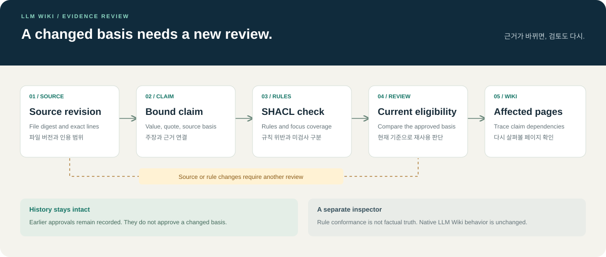
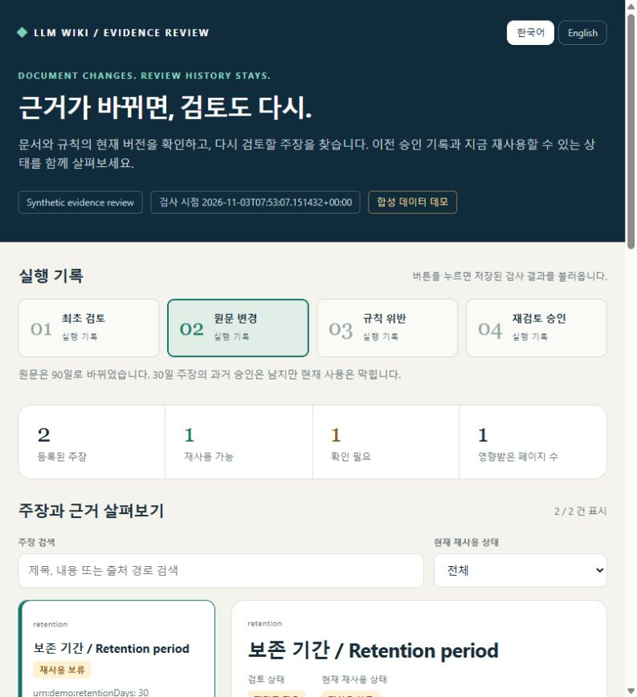

# LLM Wiki 근거 검토 확장

한국어 / [English](README.md)

**근거가 바뀌면, 검토도 다시.**

문서의 주장과 원문, 온톨로지 규칙을 함께 확인하는 로컬 검토 도구입니다. 예전 승인 기록을 보존하면서 원문이나 규칙이 바뀐 뒤 어떤 위키 페이지를 다시 살펴봐야 하는지 보여줍니다.

[nashsu/llm_wiki](https://github.com/nashsu/llm_wiki)를 기반으로 한 [SakJaeLim의 포크](https://github.com/SakJaeLim/llm_wiki)에 추가한 실험적 확장입니다. 데스크톱 앱과 기존 기능은 원저자의 작업입니다. 이번 확장은 별도의 Python 작업 공간에서 실행하며, 앱의 답변이나 기존 승인 기록에 직접 개입하지 않습니다.



## 내장 탭에서 확인한 화면

[](assets/walkthrough.mp4)

[영상 보기](assets/walkthrough.mp4). 내장 탭의 실제 화면 6장으로 구성한 24초 기록입니다. HTML에서는 단계 전환과 언어 변경, 주장 검색을 직접 해볼 수 있습니다.

<details>
<summary>근거와 승인 이력, 영어 화면 보기</summary>


</details>

## 데모 실행

Python 3.11 이상이 필요합니다. 이 폴더에서 실행합니다.

```sh
python -m pip install ".[test]"
python demo.py --output demo-output
python -m pytest -q
```

가상의 한국어 문서를 실제로 수정하고 규칙을 검사한 뒤 검토 이력을 HTML로 내보냅니다. LLM이나 API 키, 유료 서비스는 필요하지 않습니다. 처음 패키지를 설치할 때는 인터넷 연결이 필요하고, 이후 데모는 로컬에서 실행됩니다.

출력 위치는 새 폴더나 빈 폴더를 지정하세요. 기존 실행 결과를 덮어쓰지 않습니다. `demo-output/index.html`을 브라우저로 열면 단계별 결과를 볼 수 있습니다. 화면의 단계 버튼은 저장된 실행 기록을 전환합니다.

| 단계 | 바뀌는 내용 | 확인할 결과 |
| --- | --- | --- |
| 최초 검토 | 서로 다른 문서의 주장 두 개를 데모 검토자가 승인 | 두 주장 모두 현재 사용 가능 |
| 원문 수정 | 보관기간 원문을 30일에서 90일로 변경 | 기존 30일 주장은 재검토 필요 |
| 주장 수정 | 주장과 인용문을 90일로 수정하고 상한은 60일 유지 | 인용은 일치하지만 규칙 위반 |
| 규칙 수정 후 재검토 | 데모 상한을 120일로 바꾸고 새 검토 기록 추가 | 새 주장 사용 가능, 이전 기록 보존 |

관련 없는 담당팀 주장은 계속 사용 가능한 상태로 남습니다. 보관기간 수치는 동작 설명용 예시입니다.

## 내 작업 공간 검사

데모나 `examples/`의 구조를 참고해 `workspace.json`에 주장, 원문의 정확한 인용 구간, 로컬 `.ttl` 규칙 파일과 관련 위키 페이지를 등록합니다.

```sh
python -m evidence_wiki inspect PATH_TO_WORKSPACE --json inspection.json --html inspection.html
python -m evidence_wiki review PATH_TO_WORKSPACE CLAIM_ID accept --basis BASIS_FROM_INSPECTION --actor REVIEWER_NAME
```

출력 경로는 해당 작업 공간을 기준으로 지정합니다. 승인할 때 입력 파일을 다시 확인하므로 오래된 검사 결과로 바뀐 내용을 승인할 수 없습니다. 원문 대조나 규칙 검사에 실패한 주장은 승인되지 않습니다. 검토자 이름은 로컬 기록용이며 본인 인증 기능은 아닙니다.

factlog의 7열 CSV는 검토 전 초안으로 가져올 수 있습니다.

```sh
python -m evidence_wiki import-factlog PATH_TO_WORKSPACE claims.csv --out drafts.json
```

기존 CSV의 승인 상태는 새 승인으로 옮기지 않습니다. 정확한 인용문과 적용할 규칙을 연결한 후 다시 검토해야 합니다.

## 확인하는 범위

- 원문 전체의 내용 해시와 관측한 버전.
- 지정한 줄 구간의 원문과 인용문 일치 여부.
- `pyshacl`로 검사하는 제한된 범위의 로컬 SHACL 속성 규칙.
- 검토 당시 근거와 현재 근거의 차이, 누락된 파일, 관련 위키 페이지.
- 작업 공간 밖의 경로와 실행 기능을 포함한 규칙 차단.

규칙을 통과했다고 원문의 사실성이 입증되는 것은 아닙니다. 파일의 일부만 바뀌어도 그 파일에 연결된 주장을 보수적으로 재검토 대상으로 잡습니다. 의미를 해석해 변경 영향을 추론하는 기능은 아직 포함하지 않습니다.

## 다음 개발 범위

HTML은 검사 당시의 기록입니다. 실시간 감시, 검토자 인증, 위변조 방지 기능은 없습니다. 검사 사이에 내용이 바뀌었다가 되돌아온 경우에는 감지할 수 없습니다. 등록된 의존관계만 검사합니다.

LLM Wiki 기본 검토 화면과의 연결, 답변 직전 검증, SHACL 지원 확대, [OntoRipple](https://github.com/oeg-upm/OntoRipple) 연결은 후속 개발 대상입니다. 이번 작업에서 원본 저장소에 반영된 기여가 있다고 주장하지 않습니다.

실제로 실행한 검사는 [검증 기록](VERIFICATION.md)에, 상태 모델과 선행 프로젝트의 역할은 [설계 문서](DESIGN.md)에 정리했습니다. 확장도 저장소의 [GPL-3.0 라이선스](../../LICENSE)를 따릅니다.
