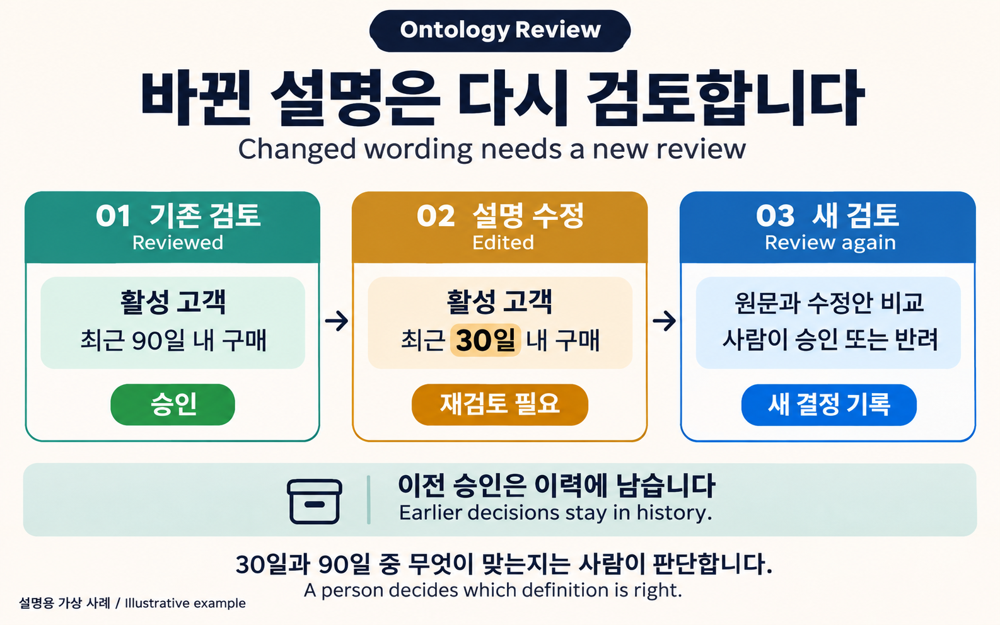
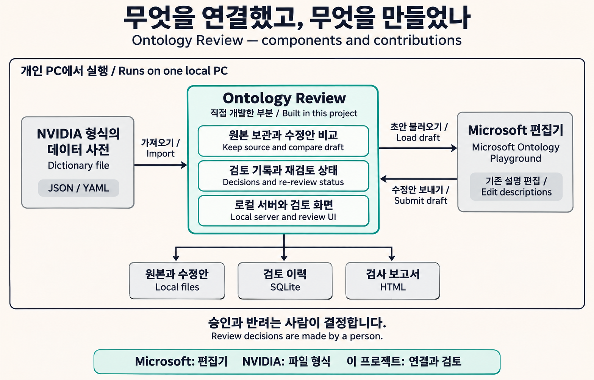
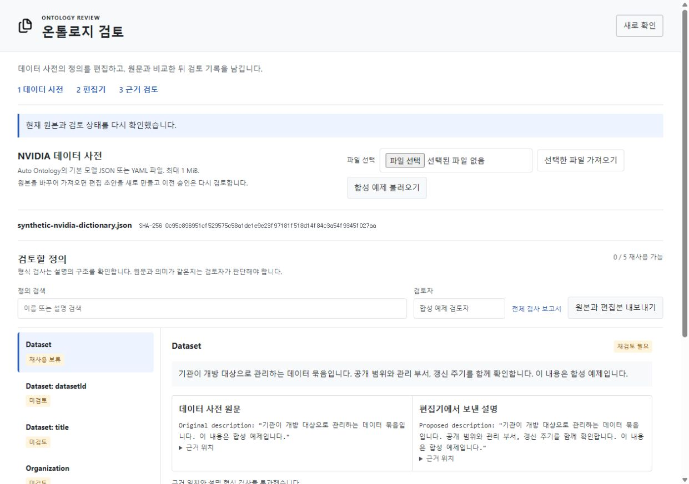
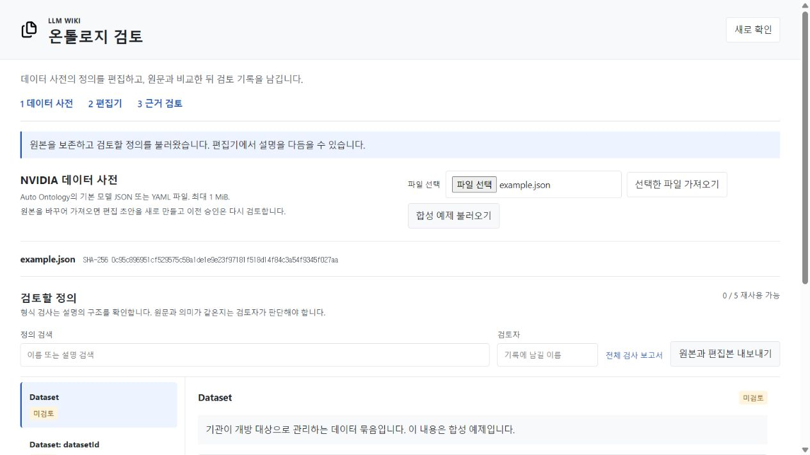
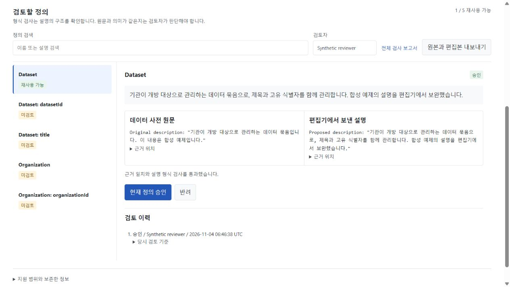
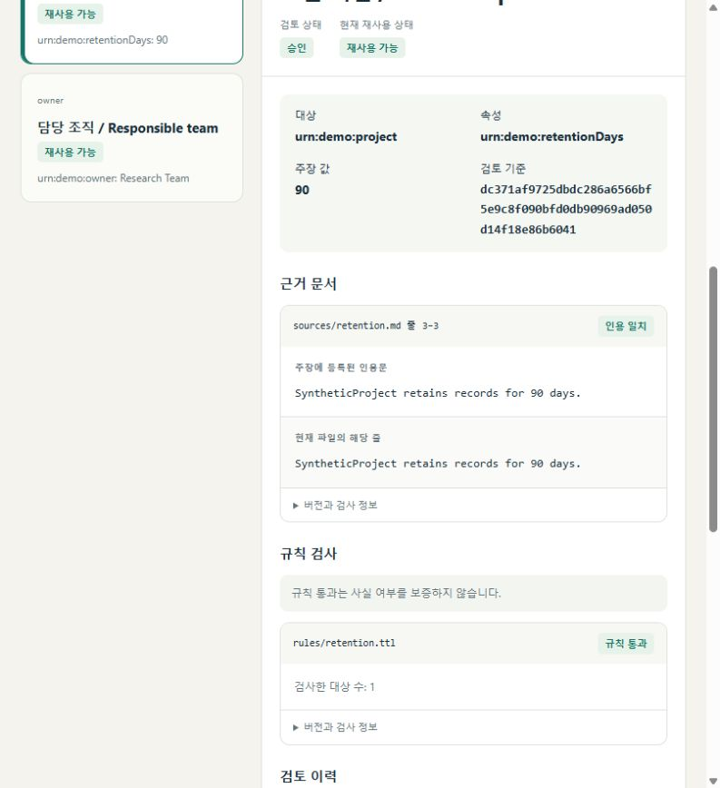
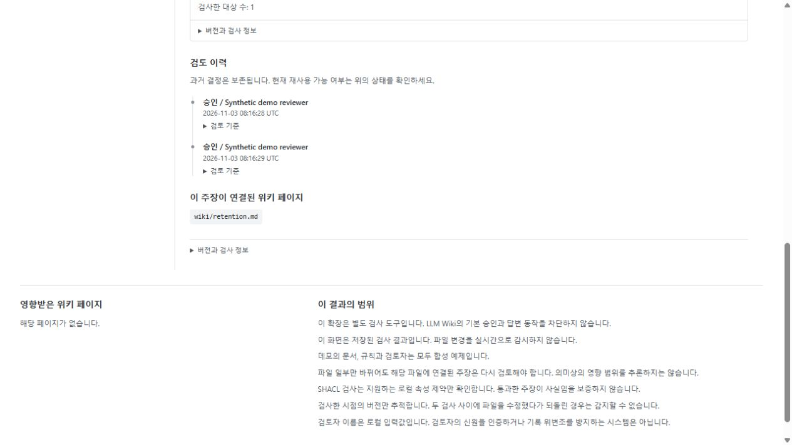
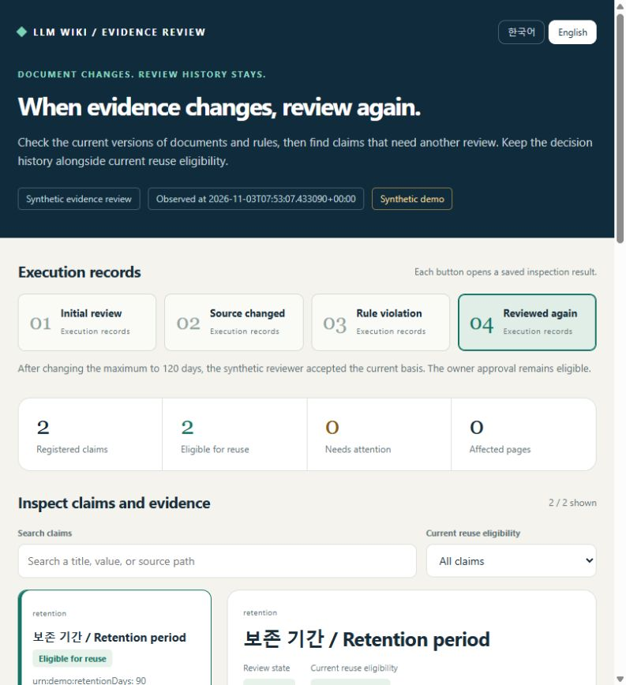

# Ontology Review

**업무 용어의 설명이 바뀌었을 때, 다시 확인할 내용을 보여주는 도구입니다.**

한국어 / [English](README.md)

[실행하기](#몇-분-안에-실행하기) / [시연 영상](#실제-화면과-영상) / [개발한 부분과 출처](PROVENANCE.md)

## 해결하려는 문제

회사에서 쓰는 **‘활성 고객’** 같은 용어는 기준을 정해야 합니다. 최근 90일 안에 구매한 사람일 수도 있고, 30일 안에 구매한 사람일 수도 있습니다. 어떤 뜻으로 정했는지에 따라 보고서의 해석이 달라집니다.

담당자가 ‘90일’이라는 설명을 확인하고 승인했다고 가정해 보겠습니다. 나중에 설명을 ‘30일’로 바꾸면 **예전 승인은 바뀐 설명까지 확인했다는 뜻이 아닙니다.** 이 도구는 그 차이를 관리합니다.



**30일과 90일 중 무엇이 맞는지는 사람이 판단합니다.** 도구가 하는 일은 어떤 내용을 확인했는지 기록하고, 변경 후에 다시 확인할 필요가 있음을 보여주는 것입니다. 실제 고객 수를 계산하거나 회사 DB를 수정하지는 않습니다.

위의 활성 고객 사례는 용도를 설명하기 위한 가정입니다. 아래 화면과 영상은 별도로 제공하는 가상 데이터 사전으로 실행했습니다.

## 어디에 도움이 되나

고객사와 용어의 뜻을 맞추는 데이터 컨설턴트, 데이터 사전을 정리하는 담당자처럼 **설명을 여러 번 고치고 확인해야 하는 사람**을 대상으로 만들었습니다. 데이터 사전은 용어와 속성의 뜻을 정리한 파일입니다.

검토할 때 원본 파일을 다시 찾아 수정안과 대조하고, 이전에 무엇을 승인했는지 확인하는 일을 한 화면에서 할 수 있습니다. 목표는 **수정된 설명을 이미 검토한 내용으로 착각하는 일을 줄이는 것**입니다. 실제 현장에서 시간을 얼마나 절약하는지는 아직 측정하지 않았습니다.

한 번 작성하고 끝나는 짧은 용어표라면 문서나 스프레드시트가 더 간단할 수 있습니다. 현재 제품은 한 사람이 PC에서 시험하는 시제품이며, 여러 직원이 로그인해 함께 쓰는 사내 시스템까지 구현한 상태는 아닙니다.

## 이번에 만든 것

기존 편집기에 **‘원문 보관 → 수정안 비교 → 검토 기록 → 변경 후 재검토’** 흐름을 연결했습니다.

- 가져온 원본 파일을 그대로 보관하고, 편집한 설명을 따로 관리합니다.
- 수정안을 검토하는 화면과 과거 결정을 남기는 기능을 만들었습니다.
- 승인한 내용이 바뀌면 다시 검토하도록 상태를 처리합니다.
- 이 흐름을 로컬에서 실행할 서버, 테스트와 데모를 만들었습니다.

화면에서 용어를 편집하는 도구는 Microsoft의 것을 연결했고, 입력 파일 형식은 NVIDIA의 것을 사용했습니다. **이 저장소에서 만든 핵심은 그 사이의 연결과 검토 기능**입니다. LLM Wiki 없이 독립 실행됩니다. [개발 이력과 출처](PROVENANCE.md)

현재 다루는 범위는 온톨로지의 **기존 용어와 속성에 붙은 설명**입니다. 관계와 구조를 새로 설계하거나, 사내 문서를 읽어 온톨로지를 자동으로 만드는 기능은 아직 없습니다.



가운데의 초록색 영역이 이 프로젝트에서 만든 부분입니다. NVIDIA 서버에 접속하는 구성이 아니라, 해당 형식으로 만든 파일을 가져옵니다.

## 실제 화면과 영상

아래 화면에서는 왼쪽의 원문과 오른쪽의 수정안을 비교합니다. **재검토 필요**는 현재 내용을 다시 확인해야 한다는 표시입니다.



**데이터 사전 편집부터 재검토까지, 20초 시연**

사전을 가져와 Microsoft Designer에서 편집하고 승인합니다. 다시 수정하면 재검토 대상으로 바뀝니다.

https://github.com/user-attachments/assets/a4a60191-5f28-4309-bd0a-af84d0a279a1

[MP4 내려받기](assets/connection-walkthrough.mp4)

<details>
<summary>원문과 규칙이 바뀌었을 때의 처리 보기 (24초)</summary>

https://github.com/user-attachments/assets/6e8241bc-d95f-42e9-82f7-452eb29e97d0

[MP4 내려받기](assets/walkthrough.mp4). 과거 결정은 이력에 남고, 원문 변경이나 규칙 위반은 새 검토가 필요합니다.

</details>

두 영상은 실제 브라우저 화면을 캡처해 이어 붙인 기록입니다. 연속 조작을 녹화한 영상은 아닙니다. 이전 확장판에서 찍은 화면에는 당시 이름이 남아 있습니다. 같은 엔진을 이번 독립 저장소로 옮겼습니다. [미디어 설명](MEDIA.md)

<details>
<summary>화면 더 보기</summary>







</details>

## 몇 분 안에 실행하기

**두 가지 실행 방식이 있습니다.** 아래 명령은 예제를 실행하고, 단계별 결과를 읽는 데모 화면을 만듭니다. 직접 설명을 고치고 승인하려면 [편집기 연결 안내](CONNECTION.md)를 따르세요. 현재 입력은 정해진 NVIDIA JSON/YAML 형식이며, 일반 Excel이나 PDF를 바로 가져오지는 못합니다.

기록형 데모에는 **Python 3.11 이상**이 필요합니다. Microsoft 편집기나 실행 중인 LLM Wiki, API 키와 모델 서버는 필요하지 않습니다. 설치할 때 Python 패키지를 내려받으며, 데모 자체는 로컬에서 실행됩니다.

```sh
git clone https://github.com/SakJaeLim/ontology-review.git
cd ontology-review
```

**Windows PowerShell**

```powershell
python -m venv .venv
.venv\Scripts\python -m pip install .
.venv\Scripts\python demo.py --output demo-output
```

**macOS와 Linux**

```sh
python3 -m venv .venv
.venv/bin/python -m pip install .
.venv/bin/python demo.py --output demo-output
```

브라우저에서 `demo-output/index.html`을 여세요. 영어 화면은 `index.en.html`입니다. 네 단계는 실제 실행을 저장한 결과이며, 재사용 가능한 주장 수는 **2 → 1 → 1 → 2**로 바뀝니다. 화면의 버튼은 저장된 기록을 보여줍니다. 다시 실행하려면 새 출력 폴더를 지정하세요.

**직접 편집하고 검토하려면** [운영체제별 편집기 연결 안내](CONNECTION.md)를 따라 실행하세요. Microsoft 편집기 포크의 고정 버전을 별도로 빌드하고, 로컬 검토 서버에 연결합니다. 이때는 Node.js도 필요합니다.

<details>
<summary>개발자용 상세 설명: 기능, 명령, 제한과 검증</summary>

## 구현한 기능

| 구성 | 하는 일 |
| --- | --- |
| 데이터 사전 어댑터 | NVIDIA Auto Ontology JSON과 안전하게 읽을 수 있는 YAML을 가져오고 정확한 원문과 해시를 보존합니다. |
| 편집기 연결 | 기존 용어와 속성을 Microsoft Designer에 연결하고, 저장 시 작업 공간 버전을 확인합니다. |
| 검토 엔진 | 확인한 내용에 명시적 결정을 연결합니다. 관찰된 변경과 되돌리기도 새 검토가 필요합니다. |
| 로컬 규칙 | 정확한 인용문과 제한된 비실행형 SHACL 규칙을 검사합니다. |
| 검토 이력 | 관찰과 결정을 SQLite에 기록하고 재시작 후에도 유지합니다. |
| 검사 보고서 | 한국어와 영어, 검색, 근거 위치, 검토 이력을 담은 독립 HTML을 만듭니다. |
| 내보내기 | 원본과 수정안, 연결 정보를 함께 보관합니다. NVIDIA에 자동 재입력하는 모델 파일은 아닙니다. |

직접 편집하는 작업 화면은 현재 한국어이며, 검사 보고서와 안내 문서는 한국어와 영어를 지원합니다.

## 직접 준비한 자료 검사하기

[가상 예제의 manifest](examples/synthetic/workspace.json)를 참고해 주장의 인용문 줄 위치, 로컬 Turtle 규칙 파일, 영향을 받는 페이지 이름을 선언합니다.

```sh
python -m evidence_wiki inspect PATH_TO_WORKSPACE --json inspection.json --html inspection.html
python -m evidence_wiki review PATH_TO_WORKSPACE CLAIM_ID accept --basis BASIS_FROM_INSPECTION --actor REVIEWER_NAME
```

만든 가상환경의 Python을 사용하세요. 설치되는 `ontology-review` 명령도 같은 기능입니다. 기존 스크립트를 위해 `evidence-wiki` 명령과 `evidence_wiki` 모듈 이름을 유지했습니다.

factlog CSV 가져오기는 미검토 초안을 만듭니다. 기존 파일의 “accepted” 값을 이 도구의 근거가 연결된 승인으로 바꾸지는 않습니다. [상태 모델과 입력 범위](DESIGN.md)

## 직접 개발한 부분과 원본의 역할

이 저장소에서 개발한 부분은 Python 검토 엔진, 데이터 사전 어댑터, 로컬 서버, 검사 화면, 테스트와 가상 예제입니다. **시각적 온톨로지 편집기는 Microsoft의 작업**입니다. [편집기 포크](https://github.com/SakJaeLim/Ontology-Playground)에 검토 서버 연결 패널과 초안 연결 처리를 추가했습니다.

처음에는 LLM Wiki 포크의 `extensions/evidence-review`에서 개발했습니다. 해당 폴더의 기능 커밋 3개를 Git subtree로 분리해 이력을 이어받았습니다. **현재 도구를 실행하는 데 LLM Wiki는 필요하지 않습니다.** 기본 위키의 승인이나 답변을 가로채는 기능은 없습니다. NVIDIA에서는 데이터 사전 형식을 활용하며 추론 서버를 배포하지 않습니다.

[기여 범위와 원본 버전, 출처](PROVENANCE.md)를 따로 정리했습니다. 독립 저장소 공개가 원본 프로젝트에 PR이 승인됐다는 뜻은 아닙니다.

## 현재 지원 범위

- 기존 개체와 속성의 설명, 온톨로지 제목과 설명을 편집합니다. 이름과 구조 변경, 연결된 속성의 순서 변경은 거부합니다.
- 작업 공간 하나에 서버 프로세스 하나를 사용합니다. 파일은 최대 1 MiB, 검토할 정의는 최대 200개입니다.
- 검토자 이름은 기록용 표시입니다. 사용자 인증, 조직별 접근 권한, 변조 방지 감사 저장소는 아직 없습니다.
- 원문 일치와 규칙 준수 여부를 확인합니다. 내용의 사실성이나 의미의 동등성은 검토자가 판단합니다.
- 변경은 검사할 때 관찰합니다. 검사 사이에 바뀌었다 되돌아온 내용은 탐지하지 못합니다. 파일 단위로 보수적으로 재검토합니다.
- Foundry 연결, 기업 데이터 파이프라인, 위키 답변 차단, 의미 기반 영향 분석은 현재 구현 범위에 없습니다.

## 검증 재현

```sh
python -m pip install ".[test]"
python -m pytest -q
python -m pip wheel . --no-deps --wheel-dir dist
python scripts/check_wheel.py dist
python scripts/check_docs.py
```

[CI](https://github.com/SakJaeLim/ontology-review/actions/workflows/ci.yml)는 Windows, macOS, Linux에서 Python 3.11과 3.14로 핵심 테스트, 데모, 패키지 검사를 실행합니다. 실제 결과와 브라우저 확인 범위는 [독립판 검증 기록](STANDALONE_VERIFICATION.md)에 남깁니다. 과거의 [엔진 검사](VERIFICATION.md)와 [편집기 연결 검사](CONNECTION_VERIFICATION.md) 기록도 보존했습니다.

</details>

Windows, macOS, Linux에서 핵심 프로그램과 설치 패키지를 CI로 검사합니다. Microsoft 편집기까지 연결한 실제 브라우저 조작은 Windows에서 확인했습니다. [검증 기록](STANDALONE_VERIFICATION.md)

## 라이선스

[GPL-3.0-only](LICENSE)를 유지합니다. 이전 고지와 출처는 [NOTICE.md](NOTICE.md)에 있습니다. Open Props와 Lucide의 별도 라이선스는 [외부 자원 고지](THIRD_PARTY_NOTICES.md)를 확인하세요. Microsoft 편집기는 자체 라이선스로 별도 빌드합니다.
