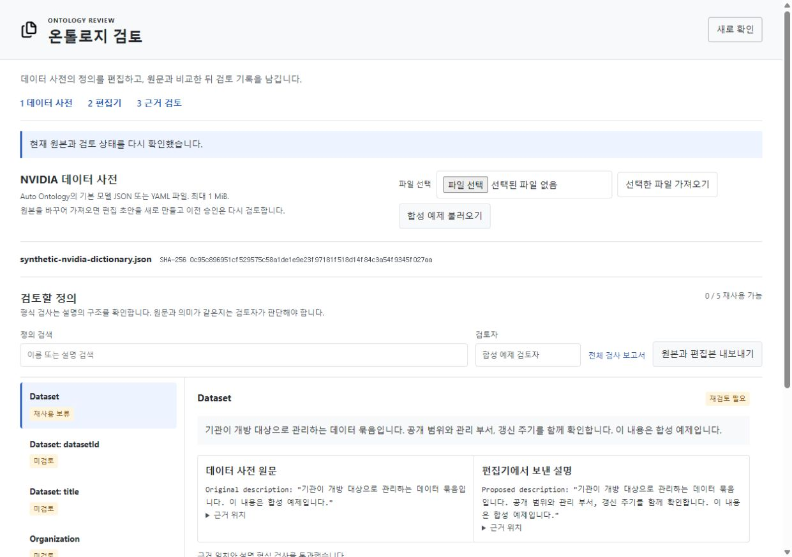
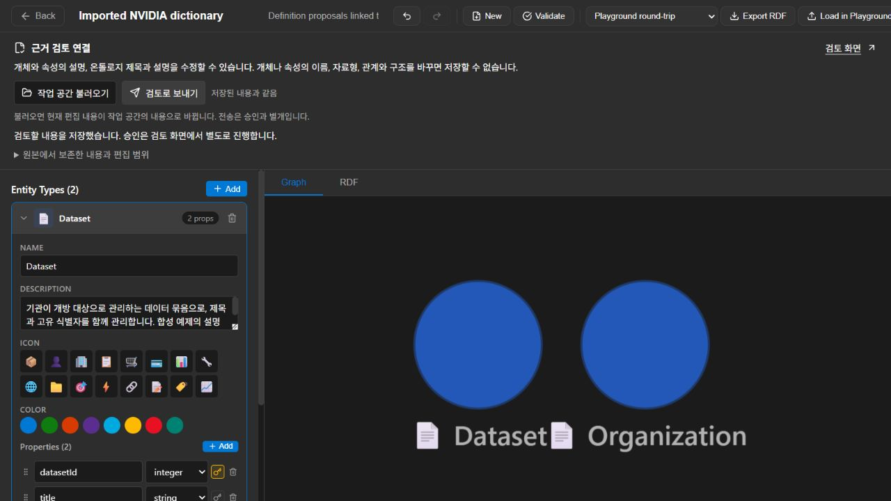
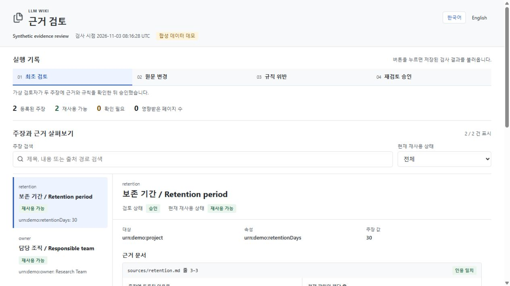
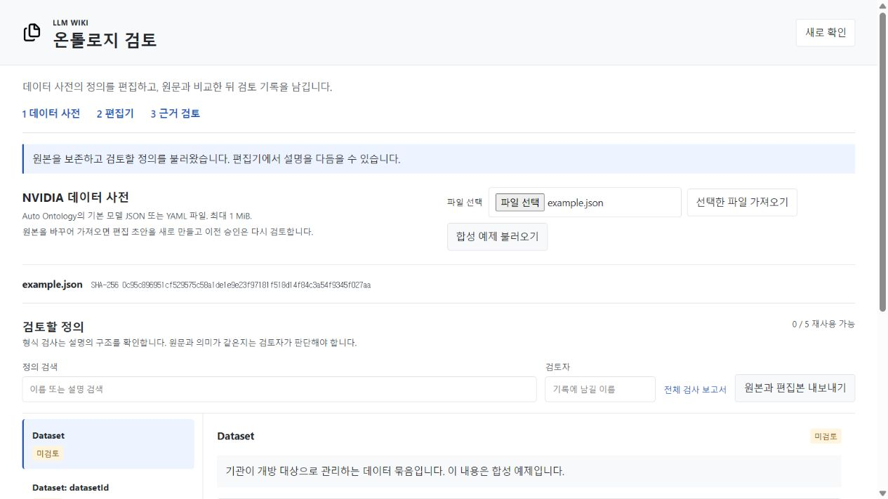
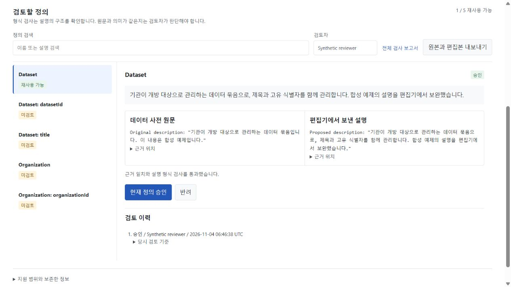
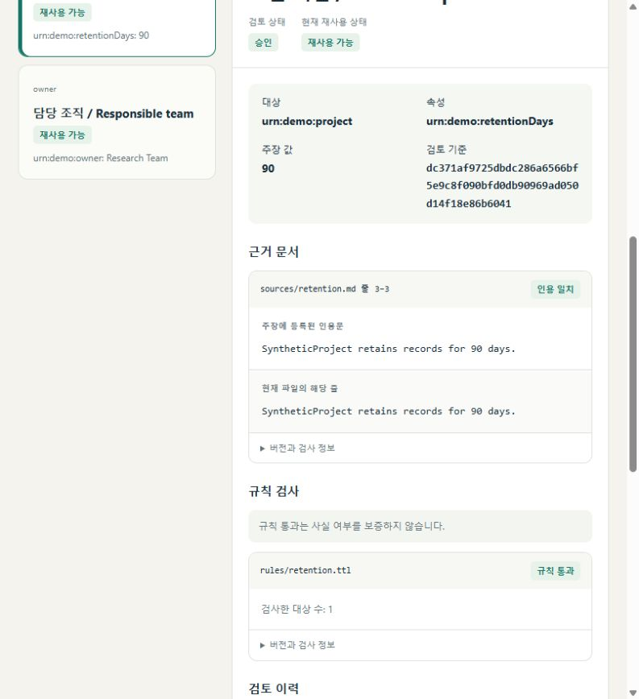
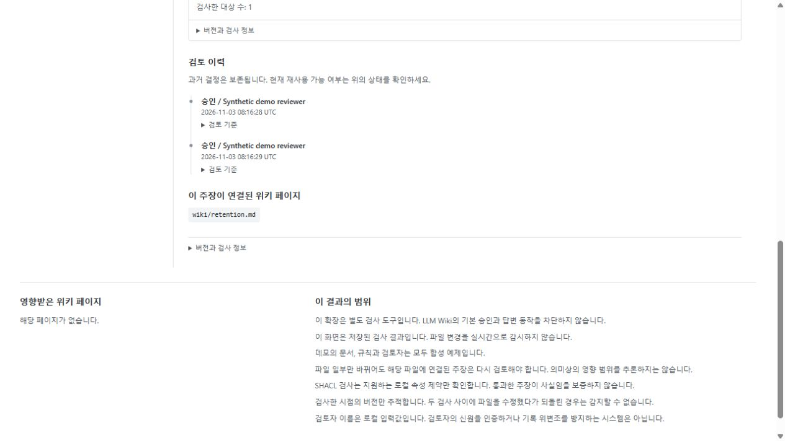
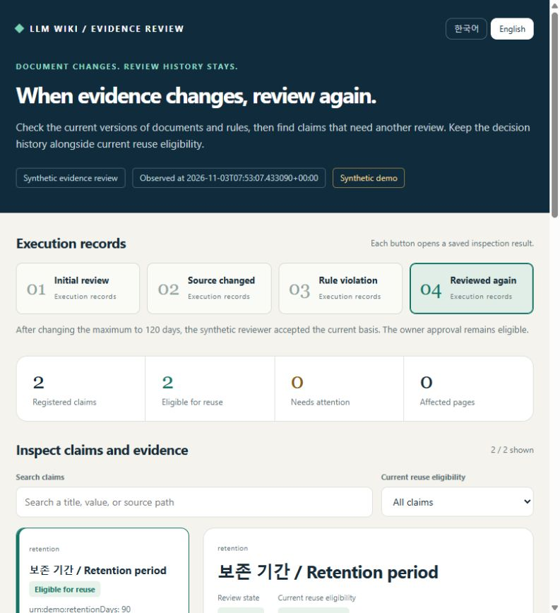

# Ontology Review

**Edit a definition. Keep its source. Know when to review it again.**

[한국어](README.ko.md) / English

[Run the demo](#try-it-in-a-few-minutes) · [Connect the editor](CONNECTION.md) · [Watch the walkthroughs](#see-it-work) · [What I built](PROVENANCE.md)

Ontology Review is a local workspace for reviewing changes to data dictionaries and source-bound claims. It keeps the original input, compares it with a proposed definition, and records a human decision against the version that was actually inspected. If that basis changes, the earlier decision stays in history and the current item needs review.

It is intended for data consultants, FDEs and data stewards preparing definitions with a subject-matter expert. The current release is a single-user prototype with synthetic demonstrations. It does not yet measure time saved or accuracy improvements in a customer deployment.



## A concrete use case

A data team receives a dictionary describing a `Dataset` as “a collection of data managed for publication.” A reviewer clarifies what the definition includes.

1. Import the dictionary and preserve the original file.
2. Load its definitions into the connected Microsoft editor.
3. Change an entity or property description and send the draft for review.
4. Compare the original and proposal, then explicitly accept or reject.
5. Edit it again. The earlier decision remains, while the current definition requires another review.
6. Export the exact original together with the separate proposal and bindings.

The bundled example contains two fictional terms and three attributes. Its source format was checked against NVIDIA's pinned model schema. The dictionary is the submitted source, not independent proof that a definition is correct.

## See it work

| Live dictionary workflow | Source and rule changes |
| --- | --- |
| [](assets/connection-walkthrough.mp4) | [](assets/walkthrough.mp4) |
| [20-second walkthrough](assets/connection-walkthrough.mp4): import, edit, review, edit again. | [24-second walkthrough](assets/walkthrough.mp4): source revision, rule failure, new review and retained history. |

These videos assemble actual browser captures. They are not continuous screen recordings. Captures from the earlier extension retain its original branding; the same engine now lives in this independent repository. [Media details](MEDIA.md).

<details>
<summary>More actual screens</summary>







</details>

## Try it in a few minutes

The recorded demo needs **Python 3.11+**. It does not need the Microsoft editor, a running LLM Wiki, an API key or a model server. Installation downloads Python dependencies; the demonstration then runs locally.

```sh
git clone https://github.com/SakJaeLim/ontology-review.git
cd ontology-review
```

**Windows PowerShell**

```powershell
python -m venv .venv
.venv\Scripts\python -m pip install .
.venv\Scripts\python demo.py --output demo-output
```

**macOS and Linux**

```sh
python3 -m venv .venv
.venv/bin/python -m pip install .
.venv/bin/python demo.py --output demo-output
```

Open `demo-output/index.html` in a browser, or `index.en.html` for English. The four stages are real stored executions with expected eligible-claim counts of **2 → 1 → 1 → 2**. Buttons inspect those records; they do not edit a live workspace. Use a new output directory for another run.

For **live dictionary editing**, follow the [Windows, macOS and Linux connection guide](CONNECTION.md). It builds a pinned version of the Microsoft fork separately and mounts it on the local review server. Node.js is needed for that editor build.

## What is implemented

| Part | Behavior |
| --- | --- |
| Dictionary adapter | Imports native NVIDIA Auto Ontology JSON or safe YAML; preserves exact UTF-8 input and its hash. |
| Editor connection | Binds existing terms and attributes to the Microsoft Designer; accepts description edits with a workspace revision check. |
| Review engine | Records explicit decisions against the inspected basis. Observed changes, including a change and reversal, require new review. |
| Local rules | Checks exact quotations and a bounded, non-executable subset of SHACL constraints. |
| Review history | Keeps observations and decisions in SQLite across restarts. |
| Inspection report | Self-contained HTML with Korean and English, filtering, source locations and decision history. |
| Export | Includes the original dictionary, edited projection and bindings. It is not an automatically rewritten NVIDIA model. |

The live workbench is currently Korean; the inspection report and these guides support Korean and English.

## Inspect your own source-bound claims

Start with [the synthetic manifest](examples/synthetic/workspace.json). Declare exact quoted lines, local Turtle rules and the names of pages that depend on each claim.

```sh
python -m evidence_wiki inspect PATH_TO_WORKSPACE --json inspection.json --html inspection.html
python -m evidence_wiki review PATH_TO_WORKSPACE CLAIM_ID accept --basis BASIS_FROM_INSPECTION --actor REVIEWER_NAME
```

Use the Python executable from your virtual environment. The installed `ontology-review` command is equivalent; `evidence-wiki` remains as a compatibility alias. The Python import name stays `evidence_wiki` so existing scripts continue to work.

A factlog CSV importer creates unreviewed drafts. It does not transfer an upstream “accepted” flag into a source-bound approval. [State model and input contract](DESIGN.md).

## What this project contributes

This repository owns the Python review engine, dictionary adapter, local server, inspection UI, tests and synthetic examples. The **visual ontology editor is Microsoft's work**; the [connected fork](https://github.com/SakJaeLim/Ontology-Playground) contains the additional connection panel and draft-binding changes.

The code originated in `extensions/evidence-review` of an LLM Wiki fork. Its three feature commits were extracted with Git subtree history. **LLM Wiki is not a runtime dependency.** Native wiki approvals and answers are not intercepted. NVIDIA contributes the dictionary format; its inference service is not deployed here.

[Contribution map, exact revisions and credits](PROVENANCE.md). Moving this code does not imply an accepted contribution to any upstream project.

## Current limits

- The live adapter edits existing descriptions and ontology title/description. It rejects structural edits, renaming and reordering of bound properties.
- One workspace supports one server process, with at most 200 reviewable definitions and a 1 MiB dictionary.
- Reviewer names are local labels, not authenticated identities. There is no multi-user access control or tamper-proof audit store.
- Checks establish source alignment and rule conformance, not factual truth or semantic equivalence.
- Source and rule changes are observed when inspected. Changes reversed between inspections are not detectable. File-level invalidation is conservative.
- There is no Foundry connector, enterprise data pipeline, native wiki answer guard or automatic semantic impact analysis.

## Reproduce the checks

```sh
python -m pip install ".[test]"
python -m pytest -q
python -m pip wheel . --no-deps --wheel-dir dist
python scripts/check_wheel.py dist
python scripts/check_docs.py
```

[CI](https://github.com/SakJaeLim/ontology-review/actions/workflows/ci.yml) runs the core tests, demo and package checks on Windows, macOS and Linux with Python 3.11 and 3.14. The actual results and browser scope are recorded in [standalone verification](STANDALONE_VERIFICATION.md); the historical [engine](VERIFICATION.md) and [connection](CONNECTION_VERIFICATION.md) records remain available.

## License

[GPL-3.0-only](LICENSE). Existing notices and attribution are retained in [NOTICE.md](NOTICE.md). Bundled Open Props and Lucide assets retain their own licenses in [third-party notices](THIRD_PARTY_NOTICES.md). The Microsoft editor is built separately under its own license.
